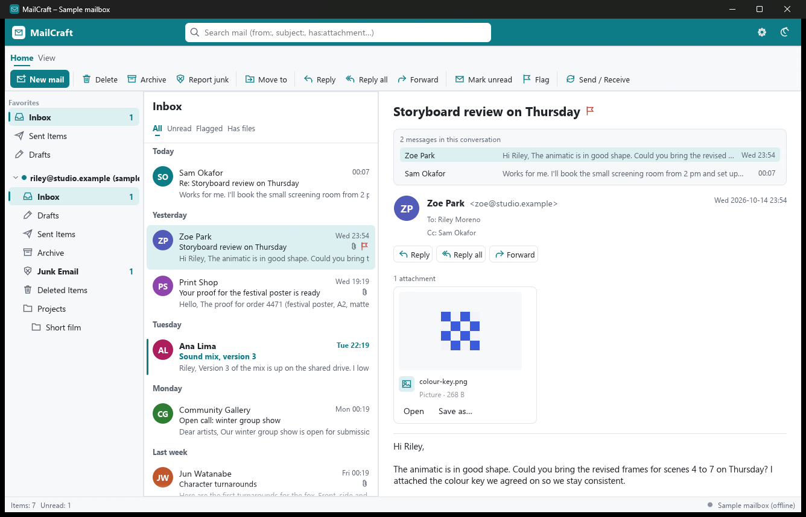
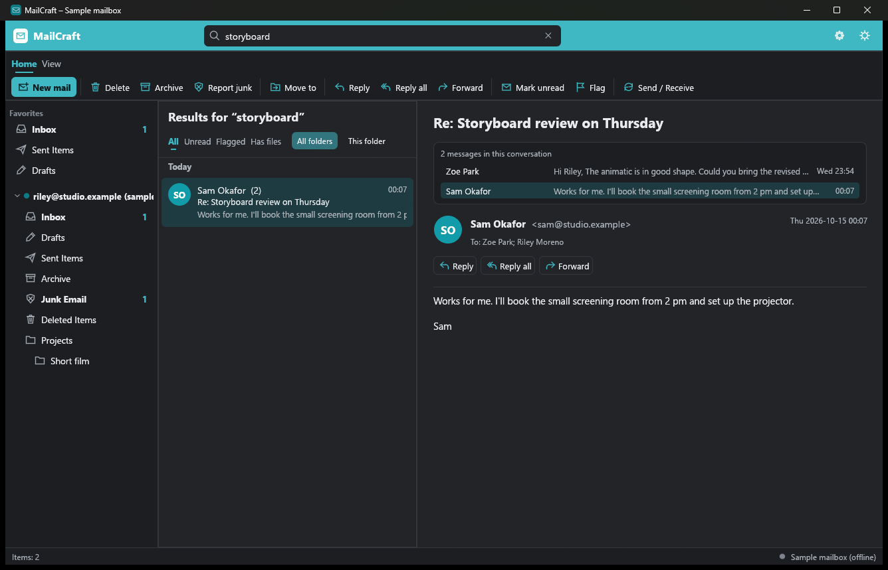
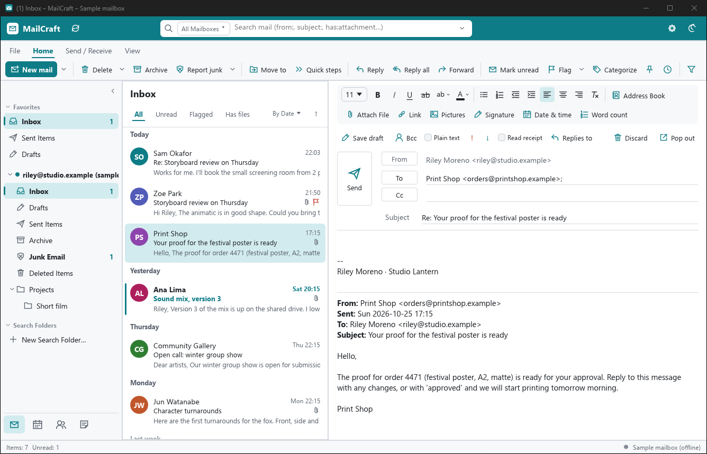

<h1 align="center">MailCraft</h1>

<p align="center">
  <b>Local-first email for creators; an open-source, clean-room alternative to Microsoft Outlook, rebuilt in pure Rust.</b>
</p>

<p align="center">
  The mail workflow you already know (folders, a message list grouped by date, a reading pane,
  Reply / Reply all / Forward, flags, Archive, Delete, Send / Receive) over IMAP and SMTP, JMAP or
  Exchange Online, with a calendar and people beside it.
  Mail is cached on your computer, so it opens instantly, searches fast and stays readable offline.
  Your password stays in the system keychain and only ever goes to your own mail server.<br>
  <i>By the ArtCraft team. Tracked in <a href="https://github.com/storytold/artcraft/issues/2177">storytold/artcraft#2177</a>.</i>
</p>

<p align="center">
  <a href="https://github.com/ZIDAN44/mailcraft/actions/workflows/ci.yml"></a>
  
  
  
  
</p>

<p align="center">
  
</p>

<table>
<tr>
<td width="50%"><p align="center"><sub><b>Search</b> across every folder, offline, with <code>from:</code>, <code>subject:</code>, <code>has:attachment</code>, <code>is:unread</code>; conversations; dark mode.</sub></p></td>
<td width="50%"><p align="center"><sub><b>Write</b> in place: replies quote the original under your signature, with attachments, Cc/Bcc and drafts.</sub></p></td>
</tr>
</table>

## Why MailCraft

- **Familiar.** Three panes, the ribbon's everyday buttons and the shortcuts people already use:
  Ctrl+N new, Ctrl+R reply, Ctrl+Shift+R reply all, Ctrl+F forward, Ctrl+Q / Ctrl+U read / unread,
  Insert flag, Delete, Backspace archive, Ctrl+Shift+V move, F9 send / receive, Ctrl+Enter send,
  Ctrl+E search, ↑ ↓ to walk the list. Drag messages onto a folder to move them.
- **Local-first.** Every folder is cached on disk with the IMAP sync state (UIDVALIDITY, UIDNEXT,
  HIGHESTMODSEQ), so a refresh costs a handful of round trips and changes made offline are
  replayed when you reconnect. See [docs/sync.md](docs/sync.md).
- **Private.** No cloud relay: the app talks to your mail servers directly over TLS. Passwords (or
  OAuth sign-ins) live in the OS keychain (Windows Credential Manager, macOS Keychain, Secret
  Service). HTML mail is shown as formatted text and pictures from the web load only when you ask,
  so trackers stay quiet.
- **Media-aware.** Picture attachments preview inline, text-like files and attached emails open in
  a preview, and files a Craft app edits get *Open in PdfCraft / WordCraft / GridCraft…*; any
  attachment opens in its default app or saves anywhere.
- **Fast.** The message list only lays out the rows on screen; search uses an inverted index over
  headers, cached bodies and attachment names.
- **Built for agents.** Every action is a command with an id. The same commands drive the ribbon,
  shortcuts, the CLI (`mailcraft-cli run mail.reply`) and startup scripting (`--cmd`).
- **Never crash.** No `unwrap`/`expect`/`panic` outside tests, hostile-input caps in the IMAP
  parser, a test that runs every command with junk parameters, and `Session::run` catches any panic.
- **Open.** MIT OR Apache-2.0, clean-room: built from the RFCs and public behaviour, every asset
  original (icons are drawn in code).

## What works today

| Area | Highlights |
|---|---|
| **Accounts** | Any IMAP + SMTP provider, JMAP (RFC 8620/8621), Exchange Online through Microsoft Graph, or an organisation's own Exchange server through EWS (NTLM or Basic sign-in, found with Autodiscover, calendars and contacts included); several accounts with an *All Inboxes* favorite; server settings found from the address (the domain's autoconfig, the Mozilla ISPDB, MX and SRV records); Gmail and Microsoft 365 sign-in through the browser (OAuth 2.0); SSL/TLS or STARTTLS; passwords in the system keychain; Outlook data files (`.pst`) open as mailboxes of their own, with their contacts and calendar, and any account exports to one |
| **Sync** | Folder list with special-use roles (RFC 6154); per-folder incremental sync (new mail, flag changes via CONDSTORE, deletions via QRESYNC); UIDVALIDITY resets; IDLE on the Inbox for instant new mail; newest messages prefetched for offline reading; changes made offline replayed; back-off reconnects; desktop notifications for new mail |
| **Reading** | Date-grouped list (Today, Yesterday, weekdays, Last week…), unread bars and bold, flags, attachment and replied markers, previews; reading pane right, bottom or off; double-click opens a message in its own window; conversations (JWZ threading); HTML shown formatted (headings, lists, links, quotes, colours, tables) with web pictures on request, remembered per sender; picture, PDF and video thumbnails; attachments dragged out to other apps; Print, Save as PDF, Save as `.eml` |
| **Organising** | Delete (to Deleted Items; permanent there, with confirmation), Archive, Report junk / Not junk, Move to (dialog or drag), Read / Unread, Flag, Pin, Snooze, colour categories, Mark all as read; Focused / Other; inbox rules; filters: Unread, Flagged, Has files; multi-select with Ctrl and Shift; folders created, renamed, moved and deleted; favourites |
| **Writing** | New, Reply, Reply all, Forward (with attachments); formatting (bold, italic, lists, headings, quotes, links) sent with a plain-text alternative; pictures inserted or pasted inline; To / Cc / Bcc suggested from mail you've seen; attachments up to 25 MB; signatures; drafts saved to the server; an Outbox for mail written offline |
| **Calendar and people** | Day, week and month views; events with recurrences and time zones; meeting invitations by mail (accept, tentative, decline, inviting guests); an address book; synced with CalDAV / CardDAV |
| **Mailbox** | The File page: account settings, automatic replies (Sieve, JMAP or Exchange), the space used, emptying Deleted Items and Junk Email, rules, Options |
| **Search** | Offline, all folders or this folder; bare words match word prefixes; `"phrases"`, `from:`, `to:`, `subject:`, `body:`, `has:attachment`, `is:unread`, `is:flagged`, `-negation` |
| **Languages** | English, Español, Français, Deutsch, Português (Brasil), Italiano, Русский, 日本語, 한국어, 简体中文, 繁體中文, العربية, עברית: following the system or chosen in Options; right-to-left mail reads right to left |
| **Platforms** | Windows, macOS, Linux (egui on the GPU), and the browser (WebAssembly; JMAP accounts) |

The full list of what's missing, ranked, is in [docs/gaps.md](docs/gaps.md).

## Quick start

Installers come from the [Releases](https://github.com/ZIDAN44/mailcraft/releases) page once a
release is cut: `.msi` and a portable zip for Windows (x64, x86, ARM64), a `.dmg` for macOS
(universal), AppImage, `.deb`, `.rpm`, Flatpak and `.tar.gz` for Linux (x86_64, aarch64, riscv64),
and a FreeBSD tarball. To run from source:

```bash
cargo run --release -p mailcraft -- --sample
```

`--sample` opens a local-only sample mailbox, so you can try everything without a server. Run
without it to add your own account (the gear button, or the welcome screen).

From the command line (passwords come from `MAILCRAFT_PASSWORD` or a prompt, never stored):

```bash
cargo run -p mailcraft-cli -- add --email you@example.com
cargo run -p mailcraft-cli -- add --email you@example.com --imap mail.example.com:993 --smtp mail.example.com:465
cargo run -p mailcraft-cli -- add --email you@fastmail.com --jmap https://api.fastmail.com/jmap/session
cargo run -p mailcraft-cli -- test
cargo run -p mailcraft-cli -- sync
cargo run -p mailcraft-cli -- list --limit 10
cargo run -p mailcraft-cli -- search "from:zoe has:attachment"
cargo run -p mailcraft-cli -- send --to friend@example.com --subject "Hello" --body "Sent from MailCraft"
cargo run -p mailcraft-cli -- commands
```

The browser version (JMAP accounts; see [packaging/web/README.md](packaging/web/README.md)):

```bash
cd apps/mailcraft-web && trunk serve
```

Then open http://127.0.0.1:8774/?sample for the sample mailbox.

The desktop app and the CLI share the cache (`%APPDATA%\MailCraft`, `~/Library/Application Support/MailCraft`
or `~/.local/share/mailcraft`; override with `--data DIR` or `MAILCRAFT_DATA`).

## Architecture

| Layer | Crate | Job |
|---|---|---|
| L0 | `model` | accounts, folders, message keys, flags, jobs and events, JWZ threading, search queries and index, dates, IMAP UTF-7 |
| L1 | `mime` | parse messages for the list and reading pane, HTML → text, attachments, build outgoing mail, reply / forward drafts |
| L1 | `store` | the local-first cache: folder state, message sources, pending offline changes, the Outbox; atomic writes |
| L1 | `print` | messages as PDF pages, with the interface font embedded |
| L2 | `jmap` | the JMAP transport, async over any HTTP client: the desktop's and the browser's `fetch` |
| L3 | `net` | native only: IMAP client on `imap-proto`, the sync algorithm, SMTP via `lettre`, JMAP push, Microsoft Graph, Exchange Web Services (NTLM), CalDAV/CardDAV, ManageSieve, HTTP, DNS, autoconfig, OAuth, Outlook data files, per-account worker threads |
| L4 | `engine` | the sans-I/O session: views, selection, compose, search, the command registry; queues jobs, applies events |
| L6 | `ui-egui` | the egui front end (thin: reads the session, runs commands) |
| apps | `mailcraft`, `mailcraft-cli`, `mailcraft-web` | the desktop app, the command line and the browser version |

The engine never touches the network: it emits `Job`s and applies `Event`s, which the app connects
to the `net` worker pool. Tests drive it with scripted events, and in-memory IMAP and JMAP servers
(and Graph, CalDAV/CardDAV and ManageSieve) servers test the real clients and sync code. Details in [docs/architecture.md](docs/architecture.md).

Quality gate before every commit: `cargo xtask ci` (fmt, clippy `-D warnings`, tests, layering,
assets, wasm).

## Packaging and releases

The scripts in [`packaging/`](packaging) build every installer (`packaging/linux/package.sh`,
`packaging/macos/package.sh`, `packaging/windows/package.ps1`, `packaging/freebsd/package.sh`),
and the GitHub workflows run them through the shared Craft pipelines in
[`storytold/craft-common-actions`](https://github.com/storytold/craft-common-actions):

| Workflow | When | What |
|---|---|---|
| `ci.yml` | every push and pull request | `cargo xtask ci` on Windows, macOS and Linux |
| `freebsd.yml` | pushes to `main`, dependency changes | build and test in a FreeBSD VM |
| `windows-arm64.yml` | pushes to `main`, weekly | cross-build the ARM64 MSI, install and run it on Windows 11 ARM |
| `packaging-lint.yml` | packaging or workflow changes | actionlint, shellcheck, PowerShell, WiX, desktop entry, AppStream, Flatpak |
| `release.yml` | a push to the `release` branch, or by hand | sign, notarize and package every platform, then draft a GitHub Release |

The version lives only in `[workspace.package]` of `Cargo.toml` (`cargo xtask version`,
`cargo xtask version set 0.2.0`). App icons are drawn by `cargo xtask icons`.

## License and credits

MIT OR Apache-2.0. Built on [`mail-parser`](https://github.com/stalwartlabs/mail-parser) and
[`mail-builder`](https://github.com/stalwartlabs/mail-builder) (Stalwart Labs, Apache-2.0 / MIT),
[`imap-proto`](https://github.com/djc/tokio-imap) (MIT / Apache-2.0), [`lettre`](https://github.com/lettre/lettre) (MIT),
[`rustls`](https://github.com/rustls/rustls) and [`ring`](https://github.com/briansmith/ring), [`html2text`](https://github.com/jugglerchris/rust-html2text) (MIT),
[`ttf-parser`](https://github.com/harfbuzz/ttf-parser) and [`miniz_oxide`](https://github.com/Frommi/miniz_oxide) (MIT / Apache-2.0),
[`quick-xml`](https://github.com/tafia/quick-xml) (MIT), [`hayro`](https://github.com/LaurenzV/hayro) (MIT / Apache-2.0),
[`outlook-pst`](https://github.com/microsoft/outlook-pst-rs) (Microsoft, MIT), [`outlook-pst-rw`](https://github.com/dongs0104/outlook-pst-rs) (MIT), [`drag`](https://github.com/crabnebula-dev/drag-rs) (MIT / Apache-2.0), [`x11rb`](https://github.com/psychon/x11rb) (MIT / Apache-2.0) and
[`egui`](https://github.com/emilk/egui). Microsoft Outlook is a trademark of Microsoft; MailCraft is
not affiliated with it and uses none of its code, icons or assets.
