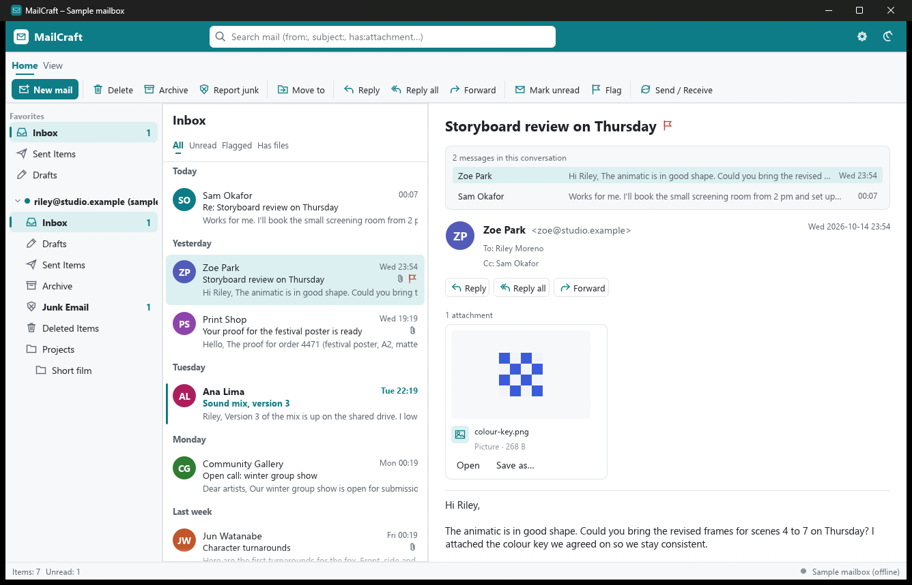
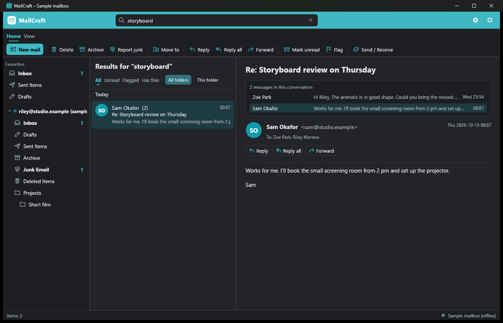
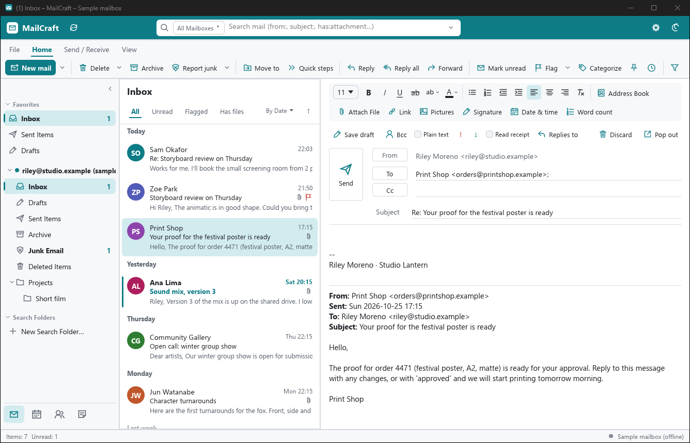

<h1 align="center">MailCraft</h1>

<p align="center">
  <b>Local-first email: an open-source, clean-room alternative to Microsoft Outlook, written in Rust.</b><br>
  <i>By the ArtCraft team. Tracked in <a href="https://github.com/storytold/artcraft/issues/2177">storytold/artcraft#2177</a>.</i>
</p>

<p align="center">
  <a href="https://github.com/ZIDAN44/mailcraft/actions/workflows/ci.yml"></a>
  
</p>

<p align="center">
  
</p>

<table>
<tr>
<td width="50%"></td>
<td width="50%"></td>
</tr>
</table>

MailCraft gives you the everyday Outlook mail workflow with your own mail servers. It keeps a copy
of your mail on your computer, so it works offline.

## Features

- **Familiar:** three panes, a ribbon and the usual Outlook shortcuts. Drag messages onto folders.
- **Accounts:** IMAP or POP with SMTP, JMAP, and Exchange Online (Graph) or on-premises (EWS). Sign in with Gmail or Microsoft 365, see *All Inboxes*, and open or export `.pst` files.
- **Works offline:** every folder is kept on disk and synced in the background. Changes you make offline go to the server when you reconnect.
- **Reading and writing:** conversations, formatted HTML, picture thumbnails, rich-text replies, signatures, drafts, an Outbox, **Print** and **Save as PDF**.
- **Organising:** archive, flag, pin, snooze, categories, Focused and Other, rules, and Undo.
- **Search:** works offline, with `from:`, `subject:`, `has:attachment`, `is:unread` and more.
- **Calendar and people:** day, week and month views, meeting invitations, an address book, and CalDAV/CardDAV, with a mail account or on their own, from any such server (Nextcloud, Baïkal, SOGo, Radicale and others).
- **Private and secure:** MailCraft talks only to your servers, always over TLS. Passwords stay in the system keychain. Remote pictures load only when you ask. S/MIME and OpenPGP sign and encrypt, and the message you're writing says whether everyone in it can receive it encrypted.
- **Everywhere:** Windows, macOS, Linux and the browser (JMAP accounts only), in 15 interface languages.
- **Scriptable:** every action is a command with an id. The ribbon, shortcuts, the CLI and `--cmd` all run the same commands.

## Install

Download an installer from the [Releases](https://github.com/ZIDAN44/mailcraft/releases) page:

- **Windows:** `.msi`, or a portable zip.
- **macOS:** `.dmg`.
- **Linux:** AppImage, `.deb`, `.rpm`, Flatpak or `.tar.gz`.
- **FreeBSD:** a tarball.

To run MailCraft portably, put a `portable.txt` file beside the app. It then keeps its data in a `MailCraftData` folder next to it.

## Build and run

```bash
cargo run --release -p mailcraft -- --sample   # local sample mailbox; drop --sample to add an account
cargo run -p mailcraft-cli -- commands         # CLI: add, sync, list, read, search, send, run
cd apps/mailcraft-web && trunk serve           # browser: http://127.0.0.1:8774/?sample
```

- The CLI reads your password from `MAILCRAFT_PASSWORD`, or asks for it. It never stores it.
- MailCraft keeps its data in `%APPDATA%\MailCraft` (Windows), `~/Library/Application Support/MailCraft` (macOS) or `~/.local/share/mailcraft` (Linux). To use another folder, pass `--data DIR` or set `MAILCRAFT_DATA`.
- To put the web build on your own site, see [hosting the web build](packaging/web/README.md).

## Documentation

- [What each version added](CHANGELOG.md)
- [What comes next](ROADMAP.md)
- [What's still missing](docs/gaps.md)
- [How MailCraft is built](docs/architecture.md)
- [How sync works](docs/sync.md)
- [How test builds update themselves](docs/updates.md)
- [Microsoft and Google sign-in](docs/oauth.md)
- [Hosting the web build](packaging/web/README.md)

## Contribute

- Start with [how MailCraft is built](docs/architecture.md).
- Follow the project rules in [CLAUDE.md](CLAUDE.md): no crashes, no Microsoft assets, clean room.
- Run `cargo xtask ci` before every commit.
- To fuzz the parsers, see [fuzzing](fuzz/README.md).
- The installer scripts live in [`packaging/`](packaging). [`storytold/craft-common-actions`](https://github.com/storytold/craft-common-actions) runs them, and `release.yml` runs on the `release` branch.

## License and credits

MailCraft is dual-licensed under MIT OR Apache-2.0.

It is built on [`mail-parser`](https://github.com/stalwartlabs/mail-parser), [`mail-builder`](https://github.com/stalwartlabs/mail-builder), [`imap-proto`](https://github.com/djc/tokio-imap), [`lettre`](https://github.com/lettre/lettre), [`rustls`](https://github.com/rustls/rustls), [`html2text`](https://github.com/jugglerchris/rust-html2text), [`hayro`](https://github.com/LaurenzV/hayro) and [`egui`](https://github.com/emilk/egui). `.pst` files go through MailCraft's own crate, written from Microsoft's published specification.

Microsoft Outlook is a trademark of Microsoft. MailCraft is not affiliated with Microsoft and uses none of its code, icons or assets.
